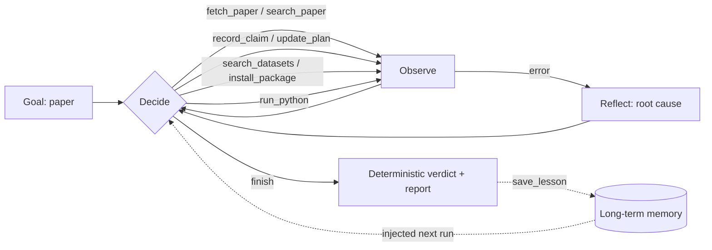

# ⚖️ Repro: an agent that checks if ML papers hold up

Give Repro a machine-learning paper. It reads it, picks one quantitative claim, finds the dataset, writes and runs the experiment itself, fixes its own bugs, and returns a verdict:

**REPRODUCED · PARTIALLY REPRODUCED · NOT REPRODUCED · COULD NOT ATTEMPT**

with the paper's number and its own number side by side, every deviation from the paper's setup, and all scripts so a human can re-run them.

## The agent loop



| Agentic concept | How Repro does it |
|---|---|
| **Planning** | Writes a step plan (`update_plan`) and keeps statuses current. Chooses which claim is feasible on *this* machine after `check_environment`. |
| **Tool use** | 10 tools: paper fetch/search (arXiv API + PDF parsing), dataset search (built-in catalog, OpenML, Hugging Face), sandboxed Python runner, allowlisted `pip install`, memory. |
| **Retrieval before acting** | Searches the paper for the exact reported number, split, and hyperparameters before writing code. |
| **Adapting to failure** | Reads tracebacks, fixes root causes, installs missing packages, shrinks data on timeouts. After 3 failures in a row it is forced to stop and reflect. |
| **Memory** | Lessons from failures are saved to `memory/lessons.jsonl` and injected into every future run. |
| **Honesty guardrails** | The agent cannot finish with a number its code never printed (checked against real run output). The verdict is computed by plain code, not by the LLM. |

## Quick start

Requires Python 3.10+.

```bash
git clone <your-repo-url> paper-repro-agent
cd paper-repro-agent
python -m venv .venv
# macOS/Linux: source .venv/bin/activate      Windows: .venv\Scripts\activate
pip install -r requirements.txt
cp .env.example .env        # Windows: copy .env.example .env
```

Put **one** API key in `.env`. Any of these work:

| Provider | `.env` line | Notes |
|---|---|---|
| Anthropic (default) | `ANTHROPIC_API_KEY=...` | |
| Google Gemini | `GEMINI_API_KEY=...` and `REPRO_PROVIDER=gemini` | Has a free tier at aistudio.google.com |
| OpenAI | `OPENAI_API_KEY=...` and `REPRO_PROVIDER=openai` | |
| Groq | `GROQ_API_KEY=...` and `REPRO_PROVIDER=groq` | Free tier |
| OpenRouter | `OPENROUTER_API_KEY=...` and `REPRO_PROVIDER=openrouter` | |
| Ollama (local) | `REPRO_PROVIDER=ollama` | Needs a tool-calling model |

Model names change often; set `REPRO_MODEL=...` to override the default for your provider.

### Run the web app

```bash
streamlit run app.py
```

Type an arXiv id (or upload a PDF), optionally add a focus hint, press **Reproduce it**, and watch the loop: thoughts, tool calls, code, outputs, the plan filling in, and the final verdict card with a chart and downloadable report.

### Or run from the terminal

```bash
python -m repro_agent examples/toy_paper.txt
python -m repro_agent 2106.11959 --focus "XGBoost RMSE on California Housing"
python -m repro_agent https://arxiv.org/abs/1106.1813 --provider gemini --max-minutes 20
```

Every run writes to `runs/<timestamp>-<paper>/`:

- `report.html` / `report.md`: verdict, claim, deviations, run table, chart
- `experiment/step_XX.py`: every script the agent ran, in order
- `trace.json`: every event, used by Replay mode
- `transcript.json`: the full LLM conversation

## Good papers to try

CPU-friendly, public data. Use the focus hint to steer the agent to a table.

| Paper | arXiv | Suggested focus hint |
|---|---|---|
| Synthetic example (offline, always works) | `examples/toy_paper.txt` | none needed |
| Revisiting Deep Learning Models for Tabular Data | `2106.11959` | "XGBoost or a simple baseline on California Housing" |
| Why do tree-based models still outperform deep learning on tabular data? | `2207.08815` | "a tree-based model on one of the small benchmark datasets" |
| SMOTE: Synthetic Minority Over-sampling Technique | `1106.1813` | "a classifier with and without SMOTE on one dataset" |

Papers that need GPUs for days, or private data, should come back as **COULD NOT ATTEMPT** with a specific reason. That is correct behaviour, and worth showing.

## Recording the demo

Real runs take minutes. In the app, open **🎬 Replay a run**, pick a finished run, and replay it at 4x or 8x while screen recording. Replays come from the real `trace.json`, so nothing is faked.

## Tests

```bash
pip install pytest
python -m pytest -q
```

The tests drive the real loop, tools, sandbox, verdict logic and report with a scripted fake LLM, so they run offline in a few seconds and need no API key.

## Project layout

```
app.py                  Streamlit UI (live run, replay, memory)
repro_agent/
  agent.py              the loop: budgets, reflection, forced finish, verdict
  tools.py              tool schemas + execution, anti-hallucination finish check
  llm.py                Anthropic + OpenAI-compatible adapters (no SDKs needed)
  paper.py              arXiv/PDF/text loading and passage search
  datasets.py           catalog + OpenML + Hugging Face search
  sandbox.py            subprocess runner with timeout and secret-free env
  verdict.py            deterministic tolerance-based verdict
  memory.py             long-term lesson memory
  report.py             markdown/HTML report and chart
examples/toy_paper.txt  synthetic offline paper
tests/                  offline tests
```

## Safety and limits

- Agent-written code runs in a separate process, in its own folder, with a timeout and with API keys removed from its environment. This protects against crashes and leaked keys, **not** against malicious code. For untrusted inputs, run inside Docker: `docker build -t repro . && docker run -p 8501:8501 --env-file .env repro`.
- `pip install` is limited to an allowlist of common ML packages (see `sandbox.py`); turn it off with `--no-install`.
- Reproducing on a subsample, fewer epochs or different defaults is logged as a deviation, so a mismatch can be read in context. A "NOT REPRODUCED" verdict means "not reproduced under these stated conditions", not "the paper is wrong".
- Default tolerances: ±1.5 points for percentages, ±0.015 for fractions in [0, 1], ±5% relative otherwise. Within 2x tolerance is "partially reproduced". Results better than the paper's claim count as reproduced.
